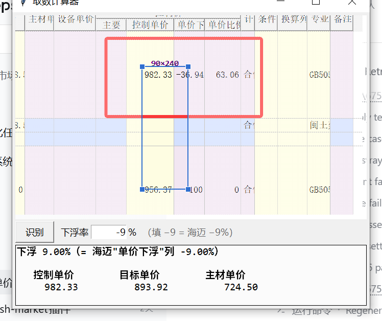

# 海迈取数计算器 / Hai-Mai OCR Calculator

一个 Windows 小工具：**框住屏幕上的数字 → OCR 识别 → 按你要的下浮率算出该填的价**。
为「海迈云计价」这类 Java/SWT 自绘表格软件做的——它们的单元格 UIA 读不到、也不能后台截图，只能"看屏幕"。

A tiny Windows utility that reads numbers straight off the screen with the built-in Windows OCR engine and does the bidding-price math for you (Chinese construction cost estimating software such as 海迈云计价).



---

## 它解决什么问题

投标组价时常见情况：招标控制价里有个「控制单价」，你要让自己的综合单价下浮到某个比例（比如 −9%）。
海迈里得反复试数、看「单价下浮」列变没变，很费时间。

这个小工具让你：

- **点一下框住「控制单价」**，直接告诉你该填的**主材单价**；
- 或者切到「调价」模式，框住「控制单价 + 当前单价下浮」两个数，直接告诉你「调整人材机」里该填的**系数**。

支持两种模式，共用一个下浮率输入框。

---

## 公式

### 模式一：主材单价（定额里只有主材）

```
综合单价 = 主材单价 × K
K        = (1 + 管理费率) × (1 + 利润率) × (1 + 税率)

目标单价 = 控制单价 × (1 + 下浮率/100)
主材单价 = 目标单价 ÷ K
```

默认费率：管理费 6.79%、利润 6.00%、税金 9.00%
→ `K = 1.0679 × 1.06 × 1.09 = 1.23385166`

> 之所以是"连乘放大"，是因为这套取费口径的**取费基数 = 人工费 + 材料费 + 机械费**，
> 主材（材料费）会被管理费、利润、税金各乘一次，所以主材占综合单价的比例被放大了 23.39%。
> 不同省市/不同工程的费率不一样，改 `config.json` 里的 `mgmt_rate / profit_rate / tax_rate` 即可。

实测回归：控制单价 `245.89`、下浮 `−9.68%` → 主材 `180.00`，反算综合单价 `222.09`。

### 模式二：调价（调整人材机系数）

海迈的「调整人材机」里填的是**定额系数**，它对定额人材机等比放大，所以综合单价是线性的：

```
目标单价 = 控制单价 × (1 + 目标下浮率/100)
当前单价 = 控制单价 × (1 + 当前下浮率/100)

系数 = 目标单价 ÷ 当前单价
     = (1 + 目标下浮率/100) ÷ (1 + 当前下浮率/100)      ← 控制价可以直接约掉
```

例：控制单价 `982.33`、当前下浮 `−36.94%`、目标 `−9%`
→ `0.91 ÷ 0.6306 = 1.443`，在「定额 系数」里填 **1.443**。

（填 1.44 得 −9.19%，填 1.45 得 −8.56%。）

### 下浮率的符号

**符号照抄海迈的「单价下浮」列**：

| 你填 | 含义 | 海迈「单价下浮」列 |
|---|---|---|
| `−9` | 下浮 9% | −9 |
| `−9.68` | 下浮 9.68% | −9.68 |
| `9` | 上浮 9% | +9 |
| `0` | 不下浮 | 0 |

---

## 运行要求

- Windows 10 / 11（自带 OCR 引擎 `Windows.Media.Ocr`，**不用联网、不用装识别库**）
- Python 3.8+ 与 [Pillow](https://pypi.org/project/Pillow/)：`pip install pillow`
- 系统里要有**简体中文 OCR 语言包**（中文 Windows 默认自带；缺失时在「设置 → 时间和语言 → 语言」里给中文加装「可选功能 → 光学字符识别」）

> 识别完全在本机完成，不发送任何数据。

## 安装

```bat
git clone https://github.com/<your-name>/hai-mai-ocr-calculator.git
cd hai-mai-ocr-calculator
pip install pillow
```

复制 `config.example.json` 为 `config.json`（首次运行也会自动生成），然后：

```bat
pythonw app.py
```

想要桌面快捷方式（带图标）：

```powershell
powershell -ExecutionPolicy Bypass -File make_shortcut.ps1
```

## 用法

1. 双击桌面图标（或 `pythonw app.py`）打开小窗口，它总在最前面。
2. 把窗口拖到计价软件的表格上，**拖窗口里那个蓝色取景框**对准数字：
   - 拖四个角 = 改大小；拖边框 = 挪位置；框外那层点状灰 = "这块不取"；
   - **框里是真透明**，能直接看见下面的数字，所以不会对错行；框内鼠标穿透，想挪框请拖边框。
3. 选模式：
   - `主材单价`：框住「控制单价」一个数；
   - `调价`：框住「控制单价 + 单价下浮」两个数（从左到右）。
4. 点【识别】，结果框里只显示一个数（保留两位小数）。
5. **结果会自动进剪贴板**，到计价软件里按 `Ctrl+V` 直接粘贴即可（多行时一次粘多行）；
   关掉本窗口后剪贴板内容依然在。
6. 改下浮率会立即重算并刷新剪贴板，不用重新识别。

模式、窗口大小、取景框位置都会被记住（存在 `config.json`）。

## 技术实现

- **截屏**：抓框内那块屏幕用 GDI `BitBlt`（`PIL.ImageGrab` 底层就是它）。
  抓之前把**整个窗口的透明度瞬间降到 0**（`-alpha 0` → 抓 → 恢复），窗口不隐藏、不重排，所以不会闪；
  实测这样抓到的画面与"真把窗口隐藏起来再抓"逐像素完全一致（色差 0.00）。
  - 注意：本程序窗口本身是"抠色透明"的分层窗口，普通 BitBlt 抓不到它，所以自测脚本里要用带 `CAPTUREBLT` 标志的 BitBlt 才能拍到自己的界面。
- **OCR**：PowerShell 通过 WinRT 调 `Windows.Media.Ocr`（与系统截图工具的「提取文本」同源）。
  `ocr_serve.ps1` 是**常驻服务**：WinRT 类型只加载一次，之后每次识别只递一个图片路径过去、按行返回 JSON
  （一次性启动 PowerShell 光启动就要 0.7 秒，常驻后每次只要几毫秒）；`ocr.ps1` 保留为一次性备用通道。
- **剪贴板**：直接调 Win32（`OpenClipboard` / `SetClipboardData(CF_UNICODETEXT)`），约 0.2 毫秒；
  比起一个 `clip.exe` 子进程（约 28 毫秒）快两个数量级，且窗口关掉后内容仍在。
  64 位下句柄必须显式声明成 `c_void_p`，否则会被截断导致写入失败。
- **预处理**（关键）：屏幕字是 ClearType 彩色抗锯齿，直接识别容易把 `6711.17` 读成 `671L 17`。所以先做
  **取最暗通道**（去掉彩色毛边）→ **二值化阈值 120** → **LANCZOS 放大 6 倍**，实测能把两张真实截图上
  6 个目标数字全部读对（不处理时只有 4~5 个）。预处理版与原图版各识别一次，取数字更全的那份。
- **数字清洗**：中文全角数字、`一`/`−` 当负号、`，`/`。` 当小数点、千分位 `1,234.56`、`O↔0`、`l/I↔1` 等都会归一。
- **几何**：Tk `geometry('+x+y')` 定的是窗口外框，而 `winfo_rootx()` 是客户区坐标，两者有边框差，
  所以取景框要按画布原点换算，不按窗口位置换算。

## 性能（本机实测）

| 环节 | 优化前 | 优化后 |
|---|---|---|
| 截屏 | 隐藏窗口 + 等 0.15 秒，会"黑一下" | 透明度瞬间归零，不闪；像素与隐藏时一致 |
| 识别 | 每次重启 PowerShell，1.1～2.2 秒 | 常驻服务：首次约 1 秒，之后 20～35 毫秒 |
| 写剪贴板 | `clip.exe` 子进程，约 28 毫秒 | Win32 接口，0.2 毫秒 |

点一次【识别】：第一次约 1.1 秒，之后约 **0.1 秒**；改下浮率只重算不重新识别，约 0.06 毫秒。

## 已知限制

- 只认**大于 1 的正数**：负数（下浮率那种 −9.68）和合计列的 `1` 之类杂讯会被丢掉——下浮率请在输入框里填。
- 必须"看屏幕"：计价软件窗口被别的窗口挡住时识别不到；最小化也不行。
- 只针对**单行**的数字框选；框到多行会输出多行（每行一个主材单价）。
- 费率是**按本工程取费口径**写死的常量（可改 `config.json`）；如果你的工程取费基数是"人工费"或"人工费+机械费"，
  那么主材到综合单价不是连乘，`K` 那条公式不适用，请用「调价」模式（它只用到下浮率，与取费口径无关）。
- 仅在 Windows 10 21H2 / Windows 11 + 简体中文 OCR 下实测过。

## 目录

```
app.py             主程序：界面、取景框、OCR 调用、计算
ocr_serve.ps1      常驻 OCR 服务（PowerShell + WinRT，首次识别时自动拉起）
ocr.ps1            一次性 OCR 备用通道（服务起不来时用）
run.bat            启动器（pythonw，无控制台）
make_shortcut.ps1  生成带图标的桌面快捷方式
config.example.json 配置示例（复制成 config.json）
config.json        你的本机配置（.gitignore 已忽略，不入库）
图标.ico           图标
docs/preview.png   界面截图
docs/使用说明.md    详细中文说明
```

## License

[MIT](LICENSE)
